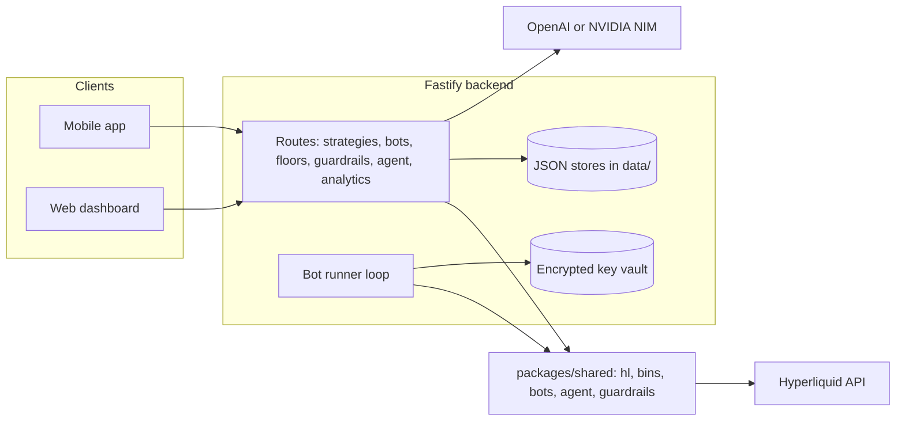

<div align="center">

# OpenCash

### Trade the news, any hour, with a max loss.

*Leverage, themed bins and an AI strategy agent on Hyperliquid — passkey wallet, server-side bots that can trade but never withdraw. Expo, Astro, Fastify, viem.*


</div>

## What is OpenCash?

Markets move on headlines at 3 a.m. on a Sunday, and retail tools give you two bad options: stare at charts all night, or hand leverage to a bot with no ceiling on what it can lose. OpenCash turns a headline or a theme into a **defined-risk position** — a basket of legs with a stop, a target, and a hard cap on how much you can lose in a day — and lets a server-side bot watch it while you sleep.

Three ways in:
- **Mobile app** (Expo / React Native) — the primary trading surface
- **Web dashboard** (Astro) — the same product in a browser, with a landing page and passkey sign-in
- **HTTP API** (Fastify) — the same engine the apps call: strategies, bots, guardrails, floors, headline translation

> The differentiator is the loss ceiling, not the leverage. Guardrails are signed by you, loosening them is delayed 24 hours, and the bot key the server holds can trade but cannot withdraw.

## Features

### Trade
- **Perps and spot** — main-book perps, HIP-3 equity/commodity perps (the `xyz` dex) and spot, with limit-first tickets and a leverage slider
- **Stops and targets** — reduce-only trigger orders per position, validated against liquidation price
- **Chart trade overlay** — entry, liquidation, target and stop drawn on the chart
- **Gasless deposit** — USDC permit on Arbitrum submitted by a relayer; withdraw back to your wallet

### Bins
- **Themed baskets** — a bin is a set of legs that move together, opened and closed in one action with per-leg results and rollback if a leg fails
- **Catalog** — `us-large-cap`, `ai-compute`, `memory-chips`, `metals`, `oil-shock`, `global-indices`, `crypto-majors`, plus weekend bins
- **Weight modes** — fixed, or allocated from live per-leg inputs (book depth caps each leg)
- **Custom bins** — build your own from any market list

### Floor
- **Upside with a floor underneath** — a barbell of USDC lent on Hyperliquid and an isolated ≤5x perp sleeve; the lent part is never margin for the sleeve
- **Lifecycle** — open, status, close, re-arm after a knock-out; one floor per market per account
- **Signed floor store** — floor records are kept server-side, authorised by owner signature

### Agent
- **Headline translator** — paste a headline; an LLM drafts a strategy card from real, liquid markets, and the server re-validates it (market list, shape, risk preview). Nothing trades until you approve
- **Strategy lab** — strategy cards (legs, weights, leverage, stop, target), previews with risk issues, templates (DCA, Donchian, grid, trail) and a simulator
- **Agent toolbox** — 7 read-only tools the model can call:

| Tool | What it does |
|---|---|
| `list_markets` | Markets with mark, volume, max leverage |
| `market_snapshot` | Price, funding and volatility snapshot for a market |
| `funding_history` | Funding rates over time |
| `price_stats` | Return and range statistics |
| `order_book` | Depth and spread |
| `compare_pair` | Relationship between two markets |
| `preview_strategy` | Risk preview for a full strategy card |

### Server bots
- **Guard or auto** — `guard` only watches an open position and closes it at the stop or target; `auto` also opens when entry checks pass, limited by cooldown and opens per day
- **Signed mandate** — every bot is bound to a SHA-256 digest of its card and mode, signed by the owner. The runner re-verifies the digest and signature before every tick and halts the bot if the card was altered
- **Trade-only agent key** — the server generates a key, you approve it on Hyperliquid with `approveAgent`, and it is stored AES-256-GCM encrypted. The runner re-checks on each tick that Hyperliquid still lists it, and halts if you revoked it
- **Guardrails enforced** — daily loss limit, max loss per trade and cool-off apply to every open, from the same signed limits the apps use
- **Fail safe** — consecutive errors halt a bot; two bots cannot share a market; a lock file keeps a single runner per host
- **Read-only preflight** — `GET /bots/:id/preflight` runs every check a live tick would run (mandate, agent key, guardrails, entry, sizing, order validation against the notional cap) and reports the exact orders it would send. It sends nothing

### Live strategies
- **Lab strategies on real orders** — Donchian breakout, DCA, grid and trailing stop run on the server against Hyperliquid, acting when each candle closes (5m to 1d)
- **Exchange-side stop** — placed after every entry and moved when the strategy moves it; if a stop cannot be placed, the position is closed
- **Survives restarts** — each processed candle is journaled and the strategy state is rebuilt by replay, so a restart never repeats an entry
- **Review before going live** — creating a bot runs a dry run that lists the exact orders it would place now; nothing is sent until you press Go live
- **Metrics from real fills** — net and return, realised, open PnL, fees, fills, volume, orders sent, position, stop and resting orders
- **Off switches** — per bot: Pause (keeps the position and its stop), Stop and close (cancels orders, closes at market), Remove; for everything: Pause all and Stop all and close, both signed by your passkey
- **Same limits as server bots** — signed mandate, guardrails on entries, 3 bots per wallet, $10 mainnet balance, one bot per market

### Guardrails, weekends and identity
- **Guardrails** — signed per-owner limits; loosening takes effect after 24 hours, tightening is immediate
- **Weekend sessions** — session calendar and gap statistics for HIP-3 markets that trade when equities are closed
- **Passkey wallet** — the account is derived from a passkey (MERA); optional private-key import sealed by the passkey
- **Ranks and share** — leaderboard and wallet analytics, X account verification via signed challenge
- **Analytics** — protocol and wallet views from public Hyperliquid data

## Server execution and the mainnet model

| Layer | Behaviour |
|---|---|
| Network gate | Bots run on testnet by default. Mainnet requires `BOT_RUNNER_ALLOW_MAINNET=true` **and** `BOT_RUNNER=1` |
| Order cap | No mainnet-specific cap. Bots have no order cap unless `BOT_MAX_ORDER_USD` is set; exits are then split into chunks under it |
| Entry | IOC limit orders with 1% slippage allowance, leverage set per leg (isolated) |
| Failed leg | Remaining legs are closed (rollback) and the bot logs the failure |
| Exit | Stop or target evaluated every 30 s from live position PnL |
| Builder fee | Optional, set by `BUILDER_ADDRESS` and `BUILDER_FEE_TENTHS_BPS` |

## Architecture



| Component | Role | Backed by |
|---|---|---|
| `packages/shared` | Trading engine: orders, triggers, bins, floor, bot engine, guardrails, agent tools | `@nktkas/hyperliquid`, viem |
| `backend` | API, headline translation, bot runner, key vault | Fastify, JSON files in `backend/data/` |
| `web` | Dashboard and landing | Astro, Cloudflare Pages (landing) |
| `mobile` | Phone app | Expo, React Native |
| Wallet | Passkey-derived account | `@category-labs/mera`, WebAuthn |

## API

| Route | Purpose |
|---|---|
| `GET /health` | Liveness |
| `POST /agent/translate` | Headline → strategy card with preview |
| `GET/POST /strategies`, `POST /strategies/:id/follow`, `/unfollow` | Shared strategies |
| `GET /bots`, `GET /bots/status` | Bots for an owner, runner state |
| `POST /bots/agent/start`, `/bots/agent/finish` | Agent key approval flow |
| `POST /bots`, `POST /bots/:id/enable`, `/disable`, `/remove` | Signed bot lifecycle |
| `GET /bots/:id/preflight` | Read-only dry run of a bot's next action |
| `GET /live`, `POST /live` | Live strategies with metrics; create with a signed mandate |
| `POST /live/:id/enable`, `/pause`, `/close`, `/remove` | Signed live bot actions |
| `POST /live/stop-all` | Signed kill switch: pause or close every bot of a wallet |
| `GET /live/:id/preflight` | Dry run of a live bot: checks plus the orders it would place, nothing sent |
| `GET/POST /guardrails`, `GET /guardrails/status` | Signed limits and current verdict |
| `GET/POST /floors`, `POST /floors/:id/remove`, `/replace` | Signed floor store |
| `GET /boards`, `GET /boards/:id`, `GET /leaderboard` | Market boards and ranks |
| `GET /analytics/protocol`, `GET /analytics/wallet` | Analytics |
| `GET /deposit/permit-params` | Gasless deposit parameters |
| `GET /identity`, `POST /identity/challenge`, `/identity/verify` | X verification |
| `POST /account/delete` | Delete account data |

## Project structure

```
.
├── backend/            Fastify API, bot runner, key vault, scripts
│   ├── src/            routes: agent, runner, guardrails, floors, strategies, analytics, deposit, identity
│   └── scripts/        testnet scripts (hl-floor, hl-bin, hl-bot, ...)
├── packages/shared/    trading engine shared by backend, web and mobile
│   └── src/            hl, bins, bots, agent, analysis, strategy, templates, guardrails, mera, identity
├── web/                Astro dashboard and landing, Cloudflare Pages config
├── mobile/             Expo app
├── contracts/          Foundry project from earlier work, not part of the Hyperliquid flow
└── docs/               research, product plan, trading flow
```

## Setup

1. `pnpm install`
2. Create `backend/.env` (see the table below)
3. `pnpm backend` — API on `:8787`
4. `pnpm web` — dashboard, or `pnpm mobile` / `pnpm android` for the app

| Variable | Purpose |
|---|---|
| `PORT` | API port, default 8787 |
| `OPENAI_API_KEY`, `OPENAI_MODEL` | Headline translator (default model `gpt-5.4-mini`) |
| `NVIDIA_API_KEY`, `NVIDIA_MODEL` | Translator fallback via NVIDIA NIM |
| `BOT_RUNNER` | `1` starts the server runner; off otherwise |
| `BOT_RUNNER_ALLOW_MAINNET` | `true` lets bots be created and run on mainnet |
| `BOT_KEY_SECRET` | 64 hex chars, encrypts agent keys. Required in production |
| `BOT_MAX_ORDER_USD` | Optional per-order notional cap for bots; unset means no cap |
| `BUILDER_ADDRESS`, `BUILDER_FEE_TENTHS_BPS` | Optional builder fee |
| `RELAYER_PRIVATE_KEY`, `RELAYER_ALLOW_MAINNET` | Deposit relayer |
| `ARBITRUM_RPC_URL`, `ARBITRUM_SEPOLIA_RPC_URL` | Deposit RPCs |
| `LEADERBOARD_MIN_EQUITY_USD` | Leaderboard filter |

## Kill switch

One flag turns the whole app off and leaves the landing page up. With it on, every API route except `/health` answers 404, the bot runner stops acting (open positions and their exchange stops stay), and every web route except the landing page shows the 404 page. Unknown routes always show the same 404 page.

```bash
SERVER=ubuntu@<server-ip> deploy/kill.sh on      # off | status
```

The flag is `backend/data/kill-switch` on the server (or `KILL_SWITCH=1` in the env). The website checks it through `/health`, so no redeploy is needed.

## Security and trust

- The agent key can trade but cannot withdraw; withdrawals need your wallet signature.
- Agent keys are encrypted at rest with AES-256-GCM, bound to the owner and network.
- Every state change (bot, guardrail, floor) is authorised by a fresh owner signature (10-minute window).
- The runner refuses to trade a bot whose card or mandate signature no longer verifies.
- Guardrail loosening is delayed 24 hours.
- Without `BOT_KEY_SECRET` the vault falls back to a local dev secret file. Do not deploy that way.

## Status

| Area | State |
|---|---|
| Typecheck (`backend`, `packages/shared`) | Passes |
| Floor, bins, bots on testnet | Run end to end on testnet per `docs/opencash-product-plan.md` |
| Mainnet | Read-only calls only. No mainnet order has been sent |
| Mainnet bot path | Gated; preflight and integrity checks are new and not yet exercised against a real saved bot |
| Live strategies | Engine tested against a simulated exchange (`templates/live.check.ts`); routes, dry runs and off switches tested locally; real orders verified on Hyperliquid testnet (`backend/scripts/hl-live.ts`: entry, exchange stop, stop and close, grid resting orders, pause). Not run on mainnet |
| Kill switch and 404 | Deployed; switched on 2026-10-12 (API answers 404 except `/health`) |
| Deposit relayer | Built, relayer key not configured |
| Translator | Needs a provider key in `backend/.env` |
| Persistence | JSON files; fine for one host, not for scale |
| Contracts | Not part of this flow; status not re-verified |

## License

No license file is committed at the repository root yet.

<div align="center">

Built with [Hyperliquid](https://hyperliquid.xyz), [`@nktkas/hyperliquid`](https://github.com/nktkas/hyperliquid), [viem](https://viem.sh), [Fastify](https://fastify.dev), [Astro](https://astro.build) and [Expo](https://expo.dev).

</div>
